# Brújula · Aprender a investigar

Laboratorio de estudio autónomo de **Métodos, Diseño y Técnicas de Investigación en Psicología** (Grado en Psicología, ESIC University). El estudiante lee la teoría, practica con desafíos y simuladores y resuelve casos con datos para JASP, acompañado por Eduar, su profesor.

Es una web estática: HTML, CSS y JavaScript, sin servidor, sin librerías externas y sin servicios de IA. Funciona en ordenador y en móvil.

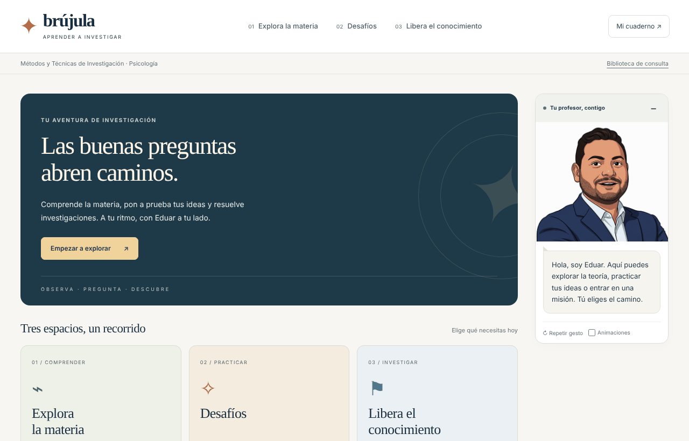

## Índice

- [Tres espacios de aprendizaje](#tres-espacios-de-aprendizaje)
- [Qué contiene](#qué-contiene)
- [Eduar](#eduar)
- [Progreso del estudiante](#progreso-del-estudiante)
- [Configuración para el profesor](#configuración-para-el-profesor)
- [Probar en local](#probar-en-local)
- [Publicar en GitHub Pages](#publicar-en-github-pages)
- [Estructura de carpetas](#estructura-de-carpetas)
- [Límites conocidos](#límites-conocidos)
- [Historial de cambios](#historial-de-cambios)
- [Licencias y créditos](#licencias-y-créditos)

## Tres espacios de aprendizaje

| Espacio | Para qué sirve |
|---|---|
| **01 · Explora la materia** | Teoría por semanas o por unidades. Cada tema abre con una pregunta central y tres conceptos de orientación; después, las secciones completas. Incluye el mapa de diseños y el comparador. |
| **02 · Desafíos** | Tarjetas de memoria, preguntas rápidas, ejercicios de emparejar, simuladores «¿qué pasaría si…?» y el diálogo «Decide como un investigador». Se filtran por tema. |
| **03 · Libera el conocimiento** | La ruta al parcial (siete misiones), el catálogo de quince casos con datos, las descargas y el simulacro. |

Además, **Mi cuaderno** guarda el progreso, las insignias y los informes, y la **Biblioteca de consulta** reúne el glosario, las amenazas a la validez y las fichas de análisis.

### Explora la materia

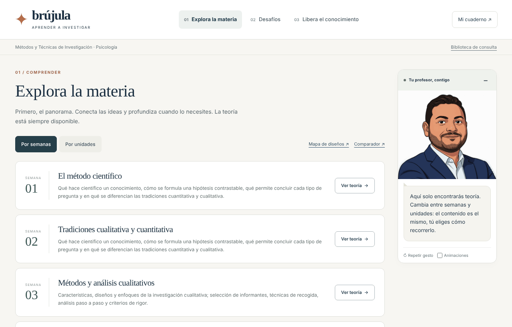

Cada unidad tiene una pregunta central y sus secciones. Ejemplo, el tema 6:

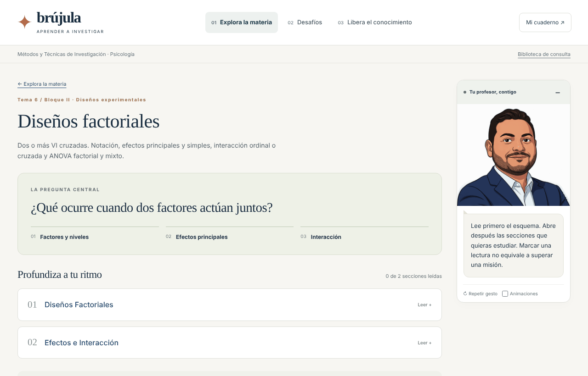

### Desafíos

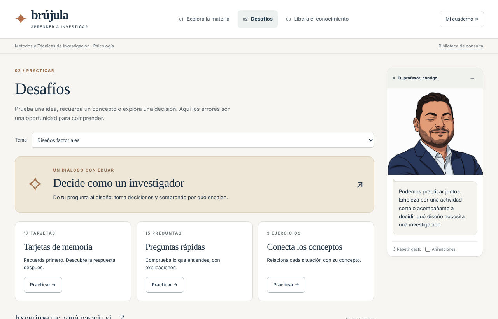

Preguntas rápidas con explicación después de cada respuesta:

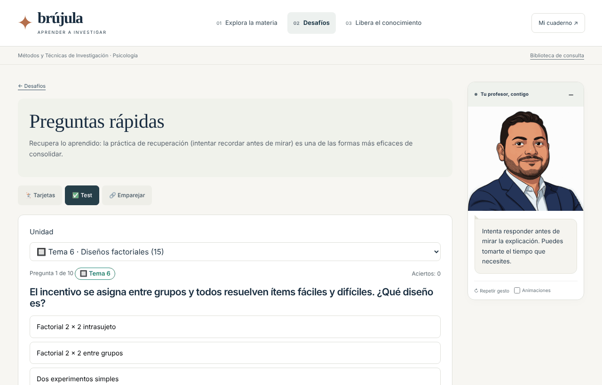

Simuladores. El más reciente, el **Laboratorio del café**, enseña por qué la interacción es simétrica e independiente de los efectos principales:

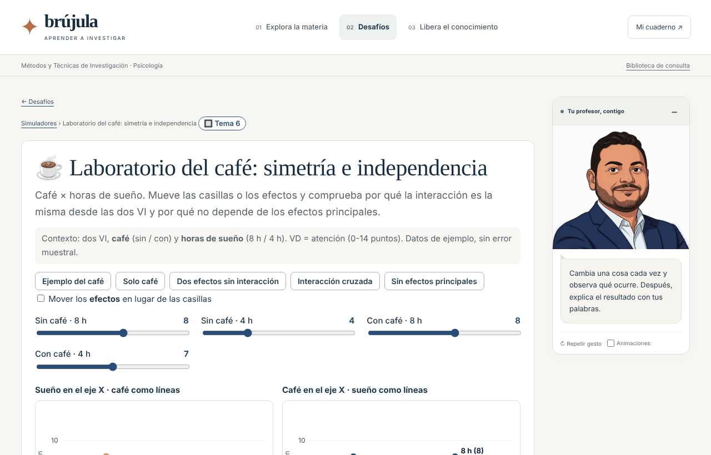

### Libera el conocimiento

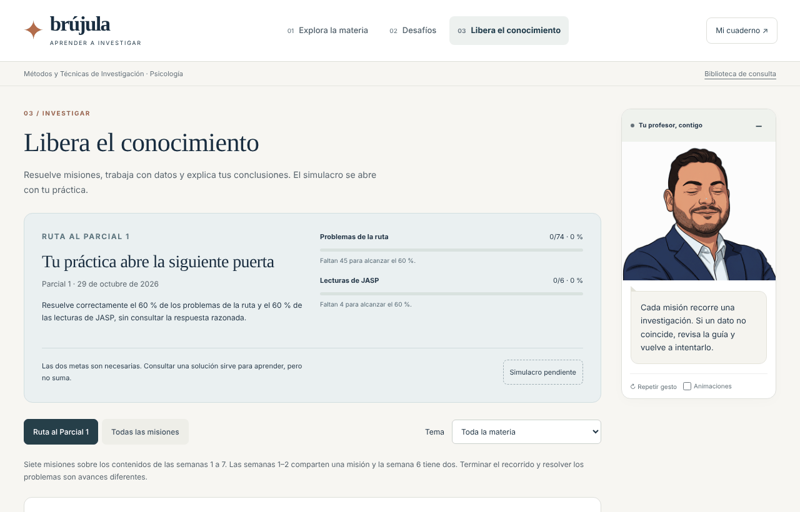

Cada misión es un caso guiado, de la pregunta a la comunicación de resultados:

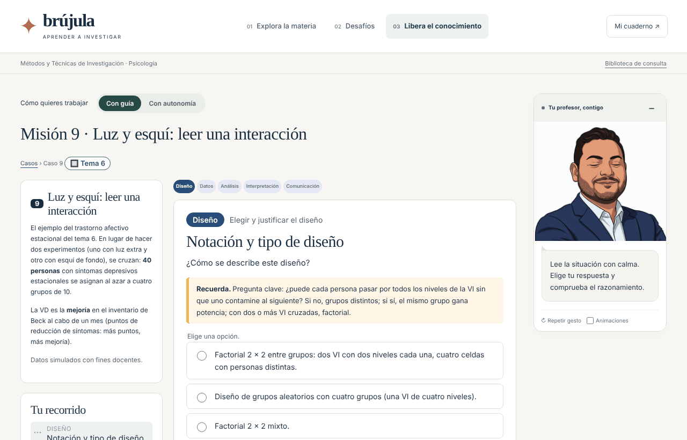

Al leer bien la salida de JASP se desbloquea la salida de referencia, con su gráfico:

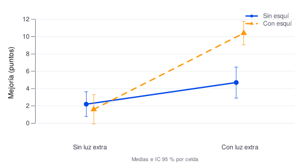

### Mi cuaderno y biblioteca

| Mi cuaderno de investigación | Biblioteca de consulta |
|---|---|
| 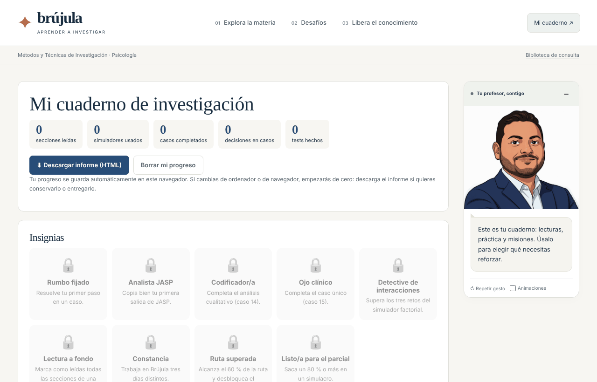 | 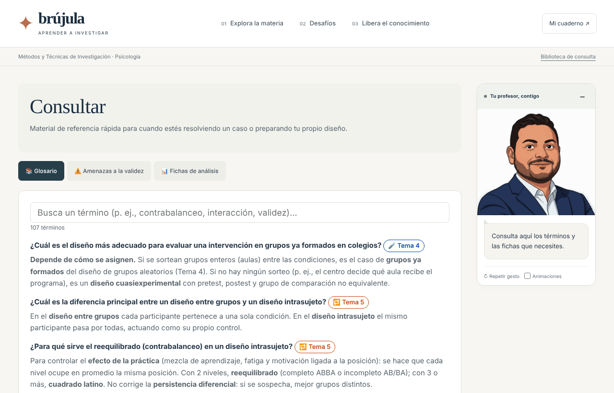 |

### En el móvil

| Portada | Laboratorio del café |
|---|---|
| 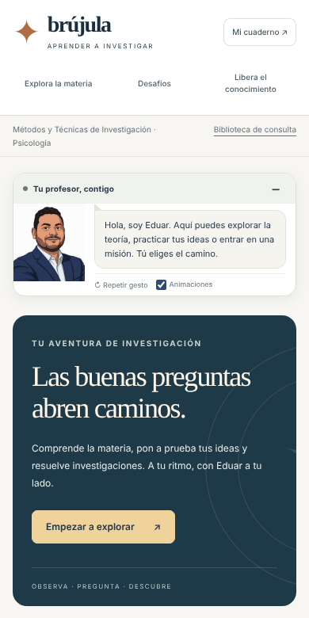 | 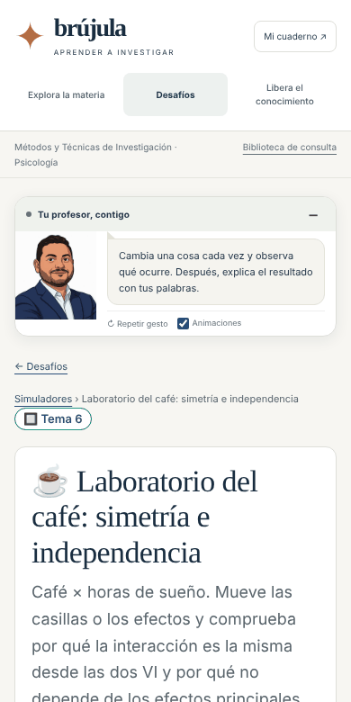 |

## Qué contiene

Datos de esta versión (20/10/2026):

| Unidad | Semana o tema | Estado | Secciones | Tarjetas | Preguntas | Emparejar | Simuladores | Casos |
|---|---|---|---:|---:|---:|---:|---|---|
| Método científico y tradiciones | Semanas 1-2 | activa | 6 | 15 | 8 | 1 | — | c13 |
| Investigación cualitativa | Semana 3 | activa | 13 | 23 | 14 | — | — | c14 |
| Experimentos con grupos distintos | Tema 4 | activa | 3 | 10 | 4 | 1 | Dos grupos | c01-c04, c12 |
| Experimentos con el mismo grupo | Tema 5 | activa | 3 | 8 | 9 | 1 | Mismo grupo | c05-c08, c12 |
| Diseños factoriales | Tema 6 | activa | 2 | 17 | 15 | 3 | Factorial 2 × 2 · Laboratorio del café | c09-c11 |
| Diseños de caso único | Tema 7 | activa | 2 | 5 | 5 | 1 | Caso único ABAB | c15 |
| Diseños cuasiexperimentales | Semana 8 | en preparación | 1 | 1 | 3 | — | — | — |
| Diseños ex post facto | Semana 9 | en preparación | 1 | 2 | 2 | — | — | — |
| Observación y encuesta | Semanas 9-10 | en preparación | 2 | 1 | 1 | — | — | — |
| **Total** | | | **33** | **82** | **61** | **7** | **5** | **15** |

**Casos.** Quince casos con 160 pasos. Doce tienen datos simulados para JASP (trece bases CSV, cada una con su diccionario de variables, y un gráfico de referencia); c04, c13 y c14 se resuelven sin datos. La ruta del parcial 1 son siete: c13, c14, c01, c05, c09, c10 y c15.

**Simulacro.** 20 ítems (5 fáciles, 10 medios y 5 difíciles) sorteados de un banco de 93 sobre las semanas 1-7. Se abre al resolver, sin ver la respuesta, el 60 % de los problemas de la ruta y el 60 % de las lecturas de JASP.

**Lectura de JASP.** En cada análisis se pide un solo dato clave (la p, la F o la ε), explicado antes en lenguaje sencillo, y después una pregunta sobre lo que significa. La tolerancia acepta los redondeos de JASP y el formato «< .001»; si el valor no coincide, el desplegable «¿No te coincide?» recoge las causas habituales.

## Eduar

Eduar acompaña desde un panel lateral, que se puede contraer, con cinco gestos: hablando, esperando, celebrando, sorpresa y reflexivo (`img/eduar/`). Sus intervenciones están escritas de antemano y responden a lo que hace el estudiante: no hay conversación libre con un modelo de IA. Las animaciones se pueden desactivar, y se desactivan solas si el sistema pide movimiento reducido.

## Progreso del estudiante

- El progreso se guarda en el navegador (`localStorage`, clave `brujula_mdi_v1`). Si se publica una versión nueva **en la misma dirección**, cada estudiante conserva su progreso.
- Otra dirección, otro navegador u otro dispositivo empiezan de cero. Para trasladarlo, en **Mi cuaderno** se descarga una copia JSON y se restaura en el nuevo sitio.
- El informe HTML descargable sirve para entregar, no para restaurar.

## Configuración para el profesor

Casi todo se cambia en **`datos/configuracion.js`**:

| Clave | Qué controla |
|---|---|
| `estados` | Unidades activas, en preparación u ocultas, por ejemplo `estados: { cuasi: "activa" }`. |
| `mostrarEnPreparacion` | Si las unidades en preparación aparecen en los menús. |
| `inicioCurso` y `cronograma` | Semanas, títulos y unidad y caso de cada semana. La portada resalta la semana actual. |
| `parcial` | Fecha del examen, casos de la ruta, umbrales (`umbral`, `umbralJasp`), reparto de dificultad e ítems por semana. |

Otras tareas:

- **Añadir una unidad.** Copia un archivo de `datos/unidades/`, cambia `id`, `orden`, `bloque`, `tema` y `titulo`, añade su `<script>` en `index.html` y enlázala en el `cronograma`.
- **Tarjetas, preguntas y emparejar.** Están en cada `datos/unidades/*.js` (`flash`, `test`, `emparejar`). El progreso de tarjetas y emparejar se guarda por posición: añade elementos al final en lugar de reordenar los existentes.
- **Simuladores.** En `js/simuladores.js`. Cada uno declara a qué unidad pertenece y aparece solo en sus Desafíos.
- **Casos y banco de ítems.** `datos/contenido.js` y `datos/items_parcial1.js` se **generan** fuera de esta carpeta (app de R y scripts del banco); no se editan a mano.

## Probar en local

Abre `index.html` en el navegador, o sirve la carpeta para probarla como en la web:

```sh
python3 -m http.server 8765 --bind 127.0.0.1
```

Después abre `http://127.0.0.1:8765`.

## Publicar en GitHub Pages

1. Sube **todo el contenido de esta carpeta**, con `index.html` en la raíz del repositorio. El archivo `.nojekyll` ya está incluido.
2. Sube también las carpetas `img/`, `graficos/` y `docs/capturas/`. Si faltan, la web no muestra a Eduar ni los gráficos de los casos, y este README no muestra sus imágenes.
3. Respeta mayúsculas y minúsculas en los nombres: GitHub las distingue (`img/eduar/eduar-reposo.png` no es lo mismo que `img/Eduar/...`).
4. En **Settings › Pages**, elige la rama `main` y la carpeta `/ (root)`.
5. Para conservar el progreso de los estudiantes, publica siempre en la misma dirección.

Si una imagen no se ve en GitHub, abre el archivo desde la lista del repositorio: si no aparece ahí, no se subió.

## Estructura de carpetas

```
index.html                   página única
css/brujula.css              estilos base (identidad ESIC)
css/experiencia.css          estilos de la versión actual (espacios, Eduar, laboratorio del café)
js/nucleo.js                 registro de contenidos, estado, rutas y utilidades
js/experiencia.js            portada, tres espacios, Eduar y navegación
js/vistas.js                 vistas de unidades, mapa y comparador, biblioteca y cuaderno
js/simuladores.js            los cinco simuladores (SVG propio)
js/casos.js                  motor de los casos
js/repaso.js                 tarjetas, preguntas rápidas y emparejar
js/parcial.js                ruta al parcial, simulacro, insignias y créditos
datos/configuracion.js       configuración del profesor
datos/mapa.js                mapa de diseños, árbol de decisión y amenazas
datos/unidades/*.js          una unidad por archivo
datos/contenido.js           casos (generado)
datos/items_parcial1.js      banco de ítems codificado (generado)
datos/*.csv                  datos simulados y diccionarios
graficos/*.svg               gráficos de referencia de los casos
img/                         logos de ESIC y gestos de Eduar
docs/capturas/               imágenes de este README
docs/CAMBIOS.md              historial de cambios
docs/historial/              documentación de versiones anteriores
```

## Límites conocidos

- El requisito del 60 % y el progreso se calculan en el navegador. Quien sepa manipularlo puede saltárselo: es una barrera pedagógica, no un control de examen. Para evaluar con garantías, usa Canvas.
- El banco de ítems está codificado para que las respuestas no se lean a simple vista en GitHub, pero no está cifrado. La versión legible del banco no debe subirse al repositorio.
- Las unidades cuasiexperimentales, ex post facto y observación y encuesta están en preparación. Las semanas 11-15 aún no tienen teoría asociada.
- El simulacro es material de preparación, no una muestra de las preguntas del examen.
- Los dos simuladores factoriales trabajan con medias, sin error muestral: muestran el patrón, no si es significativo.

## Historial de cambios

Consulta [`docs/CAMBIOS.md`](docs/CAMBIOS.md). El informe de la reorganización en tres espacios está en [`INFORME-5-FASES.md`](INFORME-5-FASES.md) y la documentación de la versión anterior, en [`docs/historial/`](docs/historial/).

## Licencias y créditos

- **Contenidos:** © 2026 Eduar Ramírez Riveros, [CC BY-NC-SA 4.0](https://creativecommons.org/licenses/by-nc-sa/4.0/deed.es). Ver [`LICENCIA-CONTENIDOS.md`](LICENCIA-CONTENIDOS.md).
- **Código:** licencia MIT. Ver [`LICENSE`](LICENSE).
- **Logotipos de ESIC University:** excluidos de ambas licencias.

Todos los datos de los casos y simuladores son **simulados** con fines docentes. Referencia principal: León, O. G. y Montero, I. (2020). *Métodos de investigación en psicología y educación: las tradiciones cuantitativa y cualitativa* (4.ª ed.). McGraw-Hill.
